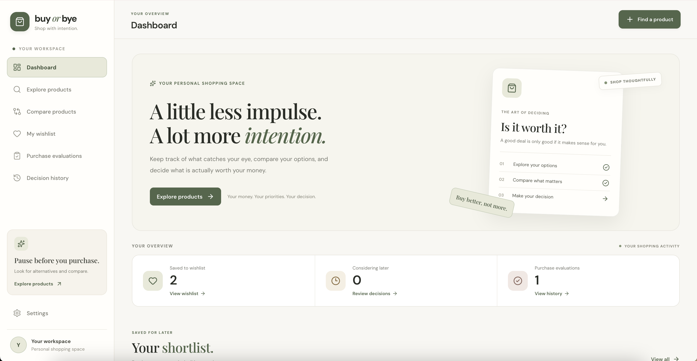
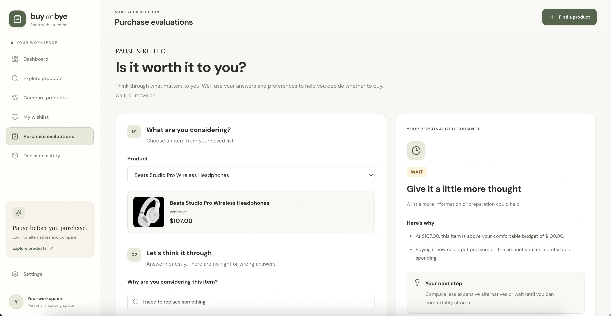
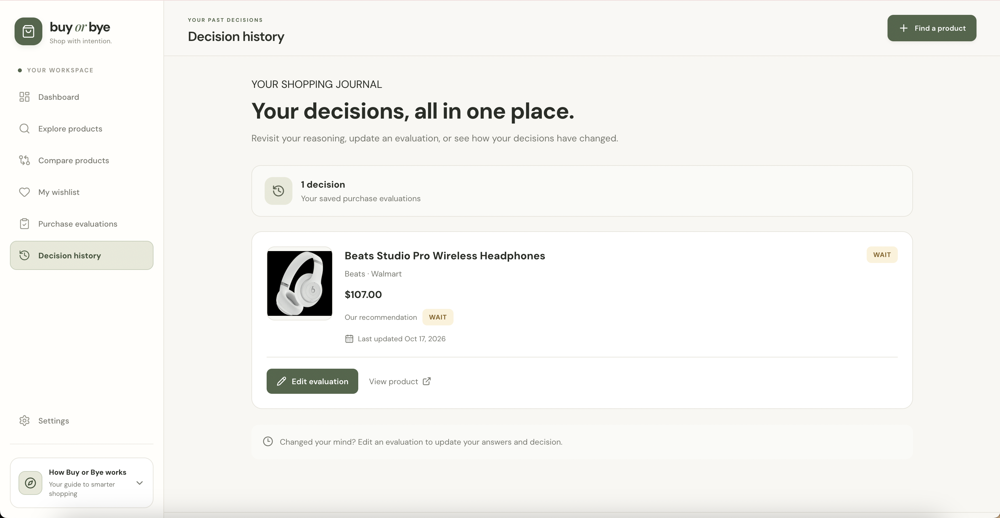

# Buy or Bye 🛍️

A thoughtful shopping companion that helps you decide whether a product is worth buying, worth waiting for, or better left behind.

Buy or Bye brings product discovery, price comparisons, wishlists, and personalized purchase evaluations into one place. Instead of making impulse purchases, users can explore alternatives, weigh their options, and make more intentional decisions based on their needs and budgets.

[**Live Demo →**](https://buyorbyebye.vercel.app/)

## Preview

### Dashboard Page

  

### Product Evaluations Page

  

### Decision History Page

  

## Features

- **Product Discovery** — Search for real products and explore product details, images, prices, and retailers.
- **Product Comparison** — Compare up to three products side by side to evaluate prices, features, and alternatives.
- **Personal Wishlist** — Save products you're considering and revisit them when you're ready to decide.
- **Purchase Evaluations** — Evaluate whether a product is worth buying, waiting for, or skipping based on your needs, budget, and priorities.
- **Decision History** — Review previous evaluations and revisit earlier purchasing decisions.
- **Personalized Settings** — Configure your budget, decision-making preferences, and preferred currency.
- **Currency Conversion** — View product prices in your selected currency using exchange-rate data.
- **Responsive Interface** — Browse products and manage purchasing decisions across desktop and mobile screens.
- **Local Data Persistence** — Save wishlists, evaluations, and preferences in your browser without requiring an account.

## Tech Stack

| Technology | Purpose |
|---|---|
| React | Component-based user interface |
| JavaScript | Application logic |
| Vite | Development server and build tooling |
| CSS | Responsive styling and layout |
| React Router | Client-side navigation |
| Lucide React | Interface icons |
| SerpApi Google Shopping API | Product search and shopping results |
| Frankfurter API | Currency conversion |
| Browser Local Storage | Persisting user preferences and decisions |
| Vercel | Deployment |

## Design & Development

Buy or Bye combines front-end development with UX/UI design to support more thoughtful purchasing decisions.

- **Decision Support** — Structure purchase evaluations around users' budgets, priorities, and individual needs.
- **Product Comparison** — Present competing options side by side to make differences easier to evaluate.
- **Information Hierarchy** — Organize product details, pricing, and decision summaries for quick scanning.
- **Reusable Components** — Build consistent, modular interface elements across product cards, comparisons, and other views.
- **Persistent Client-Side State** — Maintain wishlists, evaluations, and preferences across sessions using browser local storage.
- **Responsive Design** — Adapt layouts and interactions to different screen sizes.
- **API Integration** — Retrieve shopping results and exchange-rate data from external APIs.

## Data & Privacy

Buy or Bye does not require users to create an account. Wishlists, purchase evaluations, and preferences are stored in the browser's local storage.

Because this information is stored locally, it does not automatically sync across devices and may be lost if the browser's site data is cleared.

Product search and currency conversion use external APIs to retrieve shopping results and exchange-rate information.

## Motivation

Online shopping makes it easy to discover products, but finding the right purchase can involve comparing prices, weighing alternatives, and deciding whether something is worth the money.

Buy or Bye explores how thoughtful UX design and front-end development can help people slow down, evaluate their options, and make purchasing decisions that better fit their needs and budgets.
